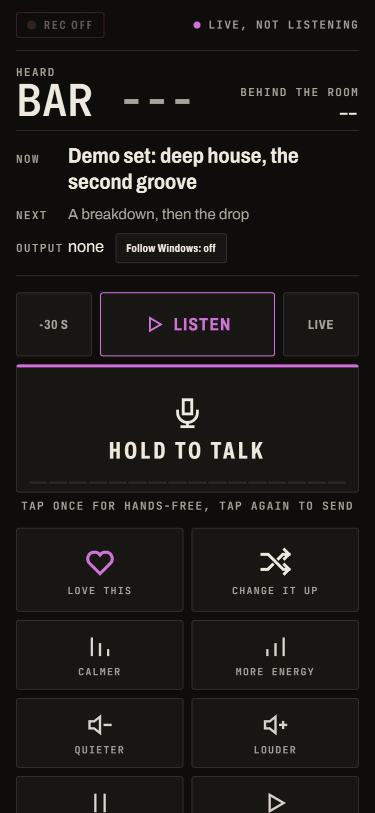
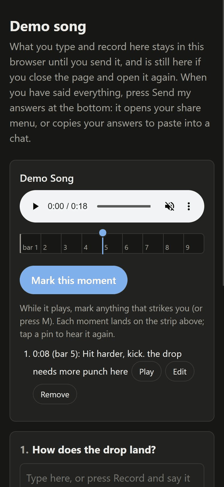
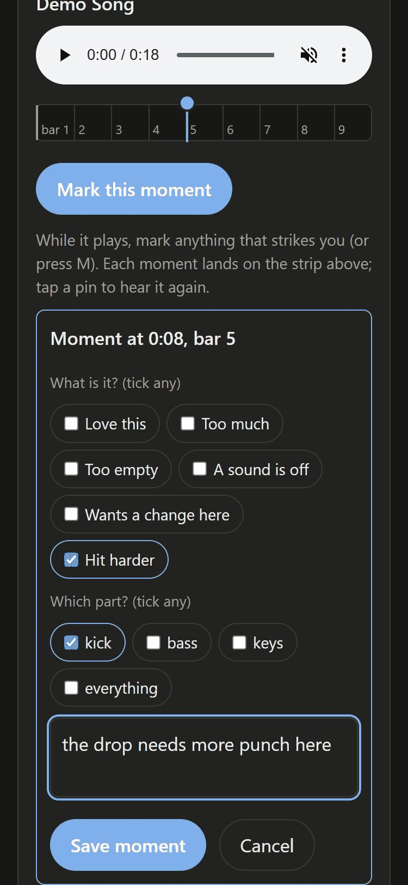

> **New here? You don't need to know music or code.** Open an AI agent that can run programs on your computer (Claude Code, Codex, Cursor, or the Code tab in the Claude desktop app) and paste this line:
>
> ```
> Set me up with ismail: https://github.com/newsbubbles/ismail
> ```
>
> It installs everything, asks what you want to make, and plays you a first idea. You don't need to know what a "skill", "MCP" or "plugin" is: your agent handles that.

<p align="center">
  <picture>
    <source media="(prefers-color-scheme: dark)" srcset="https://raw.githubusercontent.com/newsbubbles/ismail/main/assets/logo/ismail-dark.svg">
    
  </picture>
</p>

# ismail

**Not a DAW with an agent added on. ismail starts from what the agent lacks: it can't hear, so ismail reads the
music to it as text, and you steer through screens it builds for you.**

The agent you already use does the work in the background. You bring the taste.

Made by Measured Instruments: https://measuredinstruments.com (for agents: https://measuredinstruments.com/agents/)

<!-- mcp-name: io.github.newsbubbles/ismail -->

[](https://github.com/newsbubbles/ismail/actions/workflows/tests.yml)

> **If you are an AI agent:** read [AGENTS.md](AGENTS.md) first; it is short. Then the playbook,
> [skills/ismail/SKILL.md](skills/ismail/SKILL.md). Setup for every client is in
> [setup.md](skills/ismail/references/setup.md) (one command with uv:
> `uvx --python 3.12 ismail mcp`). Your first tool call is
> `guide`. Find any tool by what you need with `ops_find`. Every render comes back to you as text.

## What it looks like

**1. You talk; the agent writes the notes, the sounds and the mix as text.**

```
you   > Make me an 8-bar deep house loop: kick, a bass line in A minor, and some keys.

agent > project_new(bpm=120, length_bars=8, name='Demo Song')
        track_add('kick', instrument='preset:kick')
        notes_write('kick', 1, '0 C1 0.5; 1 C1 0.5; 2 C1 0.5; 3 C1 0.5', repeat=8)
        track_add('bass', instrument='preset:pluck')
        notes_write('bass', 1, '0 A1 0.5; 1.5 A1 0.5; 2.5 C2 0.5; 3 E2 0.5', repeat=8)
        track_add('keys', instrument='preset:pluck')
        notes_write('keys', 1, '0 A3 2; 0 C4 2; 0 E4 2; 2 G3 2; 2 B3 2; 2 D4 2', repeat=8)
        render()

        rendered 18.0s -> renders/latest.wav
        master: -16.7 LUFS, true peak -0.3 dBTP
          kick   peak  -6.1   rms -20.1 dB
          bass   peak -10.2   rms -27.6 dB
          keys   peak  -3.0   rms -26.8 dB

        Listening report
        1. Balance: the keys peak 3 dB over the kick, so they sit on top of the groove.
           I'll bring them down 4 dB and give the bass 2 dB.
        Have a listen: does the bass line feel right before I add hats?
```

**2. Every render comes back as text the agent can read: here, a song's form, bar by bar.**

```
      bar 12345678901234567890123456789012345678901234567890...
      mix 66666687787787787887888888888888888888888888888878...
     ~sub 777777777777777777777776777777666666777777777777.7...
    ~bass 7777778888888888888888888888888888888888888889888...
     root ..B...AGGAGGAGGAGGGGGGGGGGGAGGGGaAGGaGaaaaAGaaGaAG...
  section A----------------------------------------------|B--
A   bars   1-48  (48)  level    9.6 dB  low X...X...X...X...  snare ....x.......x...
B   bars  49-56  ( 8)  level   12.6 dB  low XxxXX.XxXxxXxxXx  snare .......x........
```

**3. Your phone: listen away from the desk, and send a voice note on the beat you heard.**



**4. A page built for one song: click a moment, leave a note, and the agent reads the notes in order.**

 

**5. A VR stage: stand inside the song and say what to change.**

Here is one: agents built a 1958 juke joint, then a person walked in with a headset and directed them from
inside ([watch it](https://youtu.be/fKGkaf2WYWw)).

**6. Video code gets every note's frame, so the picture lands on the beat.**

<!-- STOP 6 IMAGE: one Crossroads frame for bars 33-35, once the film's owner clears a frame for the public README. -->

```json
"kick": [
  {"f": 1600, "beat": 128.0, "pitch": 36, "len": 3, "vel": 127},
  {"f": 1631, "beat": 130.5, "pitch": 36, "len": 3, "vel": 100},
  {"f": 1650, "beat": 132.0, "pitch": 36, "len": 3, "vel": 127}
],
"snare": [
  {"f": 1625, "beat": 130.0, "pitch": 36, "len": 3, "vel": 127},
  {"f": 1675, "beat": 134.0, "pitch": 36, "len": 3, "vel": 127},
  {"f": 1725, "beat": 138.0, "pitch": 36, "len": 3, "vel": 127}
]
```

## What ismail is

ismail is a set of **recursively modifiable interfaces**. In short: the agents rebuild the screens you work through
from what you tell them, while you use them, within limits you set.

The definition: "We define a recursively modifiable interface (RMI) as a shared space between a person and their
agents, one side for each, that the agents keep rebuilding from the person's feedback while they use it, within
constraints the person sets, and where the test that decides whether a change helped can itself be changed."

In plain words: ask for a button on your phone, an object in your VR room, a new way to read a mix, and the agent
builds it from ismail's tools. The engines underneath stay put, and you decide whether a change actually helped
([why it works this way](docs/why.md)).

It is an interface, not a harness: it interfaces to your harness and interfaces to you. It connects to the agent you
already use (Claude Code, Codex, Cursor, any MCP client) on one side and to you on the other.

- **The DAW.** Your agent can't hear, so it reads. It writes music as notes, sounds and code, renders it, and reads
  every render back as text. A song is code, so "change bar 12" changes bar 12 and nothing else. Then it plays it
  live, on decks.
- **The VR stage.** A scene in your headset or browser that agents build while you stand in it. Objects carry their
  own behaviour, and when you dance, they put your moves on a character.
- **The phone page.** The set in your pocket, with the screen off. Talk back through your earbuds; the agent puts
  its own panels on the page for whatever it needs to ask you, from "sample this or play it as a melody?" to a
  listening test with the labels hidden.

The agent measures everything it can and asks your ears and eyes only what its measurements can't settle.

## Listen

**[Songs made with it](https://newsbubbles.github.io/ismail/)**, each shown with the text the agent read while making
it. The playhead runs across that text as the song plays.

| song | what it is |
|---|---|
| [Uke Story](https://newsbubbles.github.io/ismail/#ukestory) | a jam made from phone recordings of a ukulele, strums, beatbox and a voice, turned into psytrance, then a studio version |
| [Morning Six-Eight](https://newsbubbles.github.io/ismail/#sixeight) | an Afro 6/8 in D Dorian: a bembe bell, congas, flute and trumpet in thirds, triplet guitar arpeggios and a Rhodes solo |
| [Crossroads Rewired](https://newsbubbles.github.io/ismail/#crossroads) | a blues trio where a slow blues and a boogie share one song, every instrument synthesized |
| [Clair de lune in the rain](https://newsbubbles.github.io/ismail/#clairdelune) | Debussy on the measured piano, slowed and softened, with strings, harp and flute drawn from its own harmony, over rain. Piano performance: Bernd Krueger (piano-midi.de, CC BY-SA) |
| [Canopée, Russian light](https://newsbubbles.github.io/ismail/#canopee) | a live soundscape: a rainforest bed and Tambopata's birds singing their own calls, with a piano that answers them, borrowing from Rachmaninoff, Scriabin, Lyadov and early Stravinsky |
| [Windward](https://newsbubbles.github.io/ismail/#windward) | an original song for a 1970 power trio, synthesized |
| [Tambopata](https://newsbubbles.github.io/ismail/#tambopata) | dawn in a rainforest canopy: synthesized birds and a small band |
| [Mycelium Protocol](https://newsbubbles.github.io/ismail/#mycelium) | psytrance at 145 BPM, sounds fitted to a reference record's drums and bass |
| [AstraSMB](https://newsbubbles.github.io/ismail/#astrasmb) | drum and bass at 174 BPM |

One line of direction: [Frère Jacques](https://newsbubbles.github.io/ismail/#direction) on ismail's piano, the same tune
before and after one line of feedback: a canon, then minor to major. More on video: [the build
devlog](https://youtu.be/ktFhmx2axvU).

## Agents do the work, each in a role

ismail comes with roles for more than one agent, in whatever harness you use:

- a **studio agent** makes one piece (a song, a set, a scene) and only writes in that piece's folder;
- a **contributor dev** changes ismail itself on its own copy of the code, and sends it upstream when you say yes;
- an **area dev** owns one part end to end (today the stage dev, who also develops VR);
- **helpers** (subagents) take one scoped job and report back.

They hand work to each other through files, so a session that restarts picks up where it was. When your harness
has helpers and sessions that talk to each other, ismail uses them; when it doesn't, one agent does it all. ismail
itself is built this way ([the team](docs/reference.md#the-agent-team),
[development.md](skills/ismail/references/development.md)).

## Install

Paste the line at the top to your agent and it sets everything up. By hand, Python 3.10 or newer:

```bash
pip install ismail
```

That is the latest release: a version of main that passed the tests and was checked once more as an install. For the
newest work on main before it is released, install from GitHub (`pip install "ismail @ git+https://github.com/newsbubbles/ismail"`) or clone
this repo.

Then `ismail mcp` for any MCP client, `ismail -p <project> <op>` on the command line, or `from ismail import api`.
Extras and per-client setup are in [docs/reference.md](docs/reference.md).

An install without a clone has the same engine and the same playbook: the `playbook` tool reads it, and
`python -m ismail.playbook export <your agent's skills folder>` puts it where your agent loads skills. Songs go in
Documents/ismail unless `config_set('songs', <folder>)` names another (a clone keeps its own `songs/`); `config_get`
lists every setting ([docs/reference.md](docs/reference.md#settings)).

In Codex it could install as a plugin: `codex plugin marketplace add newsbubbles/ismail`, then `ismail` from the
plugin list (checked against Codex's docs and a server handshake, not yet in a live Codex session). It runs the server
with uvx, so it needs [uv](https://docs.astral.sh/uv/).

### Store packages

One command builds the package for every harness store from one metadata file (`packaging/listing.json`, version
from `pyproject.toml`), all pointing at the same server (`ismail mcp`):

```bash
python -m ismail.release --all            # writes dist/<target>/, validates each against its store's rules
python -m ismail.release --all --sync     # also rewrites the committed manifests below
python -m ismail.release --list           # the targets and how each client starts the server
```

| target | what it makes | how the server runs |
|---|---|---|
| `openai` | `dist/openai/ismail-openai-skills-<version>.zip`: the skill only, for the OpenAI plugin directory that ChatGPT and Codex share (upload under Skills only). Also `.codex-plugin/` and `.agents/plugins/marketplace.json` in this repo, the Codex marketplace above | The zip carries no server: the directory takes only remote HTTPS servers, so the skill sets ismail up on the computer. The Codex marketplace starts `uvx ... ismail mcp` over stdio |
| `claude-code` | `.claude-plugin/plugin.json` and `marketplace.json` in this repo, and `dist/claude-code/ismail-claude-code-<version>.zip` of the plugin to share | Claude Code starts `uvx ... ismail mcp` over stdio |

Two builds of the same checkout give the same bytes. `tests/test_store_plugins.py` checks each target and starts
its declared server for an MCP handshake.

## Where to look

| you want | read |
|---|---|
| to set it up as an agent | [AGENTS.md](AGENTS.md), then [setup.md](skills/ismail/references/setup.md) |
| how to make music with it (the playbook) | [skills/ismail/SKILL.md](skills/ismail/SKILL.md) |
| what is built, every tool area, install details | [docs/reference.md](docs/reference.md) |
| every instrument and effect by family, how each did by ear, what is missing | [docs/KIT.md](docs/KIT.md) |
| why it works this way, with the numbers | [docs/why.md](docs/why.md) |
| what is done and what is next | [ROADMAP.md](ROADMAP.md), [CHANGELOG.md](CHANGELOG.md) |
| to change ismail itself | [development.md](skills/ismail/references/development.md) |
| to give something back (no git needed) | [contributing.md](skills/ismail/references/contributing.md) |

## Where it falls short

- A new song from a blank page is the weak spot: the first sketch can sound generic and miss the genre's identity.
  It is strongest where there is something to measure: a reference to recreate, a song to play live, a scene to
  build.
- Singing: ismail speaks (text to speech) and has no singing voice yet. Suno sings, and makes a polished song from
  one sentence.
- Mimic needs more notes for instruments whose colour changes from note to note, like the piano (the `grand_piano`
  voice is the better piano today). Bowed strings miss a last crispness, and notes don't glide into each other yet.
- One tempo per project. MIDI files go in and out (`midi_write`, `midi_read`), and a live set takes MIDI from a
  keyboard, maps a controller's knobs and pads to its params (`live_map`), and sends its notes and MIDI clock out to synths and other apps (`live_midi_out`, `live_midi_clock`),
  and a performer's lanes go in and out as pitch bend, pressure, CCs and MPE (in files, and from a played keyboard),
  but no clock in or Ableton Link yet, no plugin hosting.
- The agent's own changes to a live set land between its turns, 5 to 30 seconds apart (your taps on the phone or
  the stage act at once).
- The VR stage is tested on one headset (Quest 3) with one person.
- It needs a capable agent, and your ear stays the final judge. The listening tests so far had one listener.

How it compares with Suno, streaming models such as Lyria RealTime, and bridges into Ableton or FL Studio: see the
[showcase page](https://newsbubbles.github.io/ismail/#compare).

## Contributors

- **Nate Codes** (newsbubbles): author and maintainer.
- **eddiehavila**: [PR #116](https://github.com/newsbubbles/ismail/pull/116), the Docker image works under a non-root
  `--user` with no extra flags.
- **The agent team**: AI agent sessions, each with one role ([who does what](docs/reference.md#the-agent-team)).
- **Sample sources**: the recorded sets behind the measured and sampled voices, with their licences, are in
  [docs/reference.md](docs/reference.md#sample-sources).

Made something with it? Open an issue with the song (a link is fine) and the prompt you gave your agent. The best
ones go on the [showcase page](https://newsbubbles.github.io/ismail/).

## Please credit

ismail is MIT-licensed: use it for anything, commercial work included. We only ask, as a request and not a licence
term, that when you publish something made with ismail, you say so.

- Music, videos, posts: "Made with ismail" and a link to https://github.com/newsbubbles/ismail. The `credits` op
  writes CREDITS.md with that line and the recordings the agent measured; keep it with the piece.
- Papers and reports: use "Cite this repository" on GitHub (from `CITATION.cff`).
- If your agent measured someone else's recording to model a sound, credit them too; CREDITS.md lists them.

## License

MIT, see `LICENSE`.
